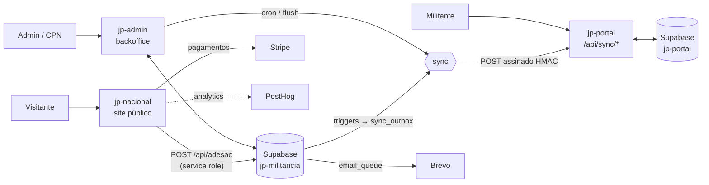

# Arquitetura

## Visão geral

- **Duas bases de dados Supabase**: `jp-militancia` (fonte de verdade dos militantes, estrutura, conteúdo, loja) e `jp-portal` (comunidade: mural, fórum, sondagens, eventos, wiki, mensagens).
- **O portal nunca lê os militantes diretamente**: recebe-os por sincronização assinada (`SYNC_SHARED_SECRET`).
- O site público e o admin escrevem na `jp-militancia`; o site público usa a *service role* apenas em rotas de servidor.

## Fluxos principais

### 1. Adesão
1. O candidato preenche `/aderir` (3 passos: dados pessoais, morada, documento) no `jp-nacional`.
2. `POST /api/adesao` valida com Zod, aplica *rate limit* por IP (Upstash), ignora bots (campo *honeypot* `website`), valida o ficheiro (JPG/PNG/PDF, máx. 8 MB) e grava:
   - o ficheiro no bucket privado `documentos-identificacao` (pasta `pendentes/`);
   - o registo em `membership_requests`, ligado ao distrito/concelhia escolhidos (a concelhia é criada, inativa, se ainda não existir).
3. São enviados emails ao candidato e à CPN (`EMAIL_CPN`).

### 2. Aprovação / recusa (jp-admin)
- **Aprovar** (papel mínimo `administrador`): a Server Action chama a Edge Function `approve-membership`, que valida o JWT e o papel (`cpn` ou `administrador`), executa a RPC `approve_membership_transaction` e envia o email de aprovação via Brevo. A RPC corre numa transação: exige o nº do cartão de cidadão preenchido na revisão, cria o utilizador Auth (só email), o perfil `militante`, o militante com número `<código do distrito>-<6 dígitos>` e os dados sensíveis, e regista em `audit_log`.
- **Recusar**: exige motivo (10–500 caracteres); um trigger (`trg_enqueue_membership_rejected_email`) enfileira o email.
- O cartão de cidadão só é visível através de um *signed URL* temporário (`getCitizenCardSignedUrl`).

### 3. Sincronização jp-militancia → jp-portal
1. Triggers na `jp-militancia` escrevem eventos na tabela `sync_outbox`: `member_approved`, `member_revoked`, `member_transferred`, `member_role_changed`, `member_catalog_concelhia`, `event_upserted`, `event_deleted`.
2. O processamento da fila corre:
   - logo a seguir a ações do admin (`flushSyncOutboxAfterResponse`);
   - em cron diário na Vercel (`/api/cron/sync-outbox`, 06:00 UTC);
   - existe também a Edge Function `sync-outbox-processor` (autenticada por `X-Cron-Secret`), agendada por `pg_cron` — **mas esse agendamento está com valores de substituição** (ver `PONTOS-DE-ATENCAO.md`).
3. Cada evento é enviado por POST com cabeçalho `X-Sync-Signature` (HMAC-SHA256 do corpo com `SYNC_SHARED_SECRET`) para `PORTAL_SYNC_MEMBER_URL` ou `PORTAL_SYNC_EVENT_URL` (eventos `event_*` vão para o segundo).
4. Em caso de falha há *retry* com *backoff* exponencial (`min(2^tentativas, 60)` minutos), até 8 tentativas; depois o evento fica `falhado` com `last_error`.
5. O portal mantém um registo da sincronização na tabela `sync_log`.

### 4. Emails
- Emails transacionais do site público: SMTP Brevo (`BREVO_SMTP_*`).
- Emails do backoffice: tabela `email_queue` → processados por `/api/cron/email-queue` (07:00 UTC) ou pela Edge Function `email-queue-processor`, que mapeia `template_key` → `brevo_template_id` através da tabela `email_templates`. Lotes de 50, até 6 tentativas.

### 5. Login
- **jp-admin**: email + palavra-passe, **TOTP obrigatório** (inscrição por QR no primeiro acesso), sessão com *cookies* `httpOnly`/`sameSite=strict` e expiração por 30 min de inatividade. Tentativas limitadas por IP.
- **jp-portal**: *magic link* por email (sem palavra-passe), com *rate limit* (5 pedidos / 10 min por IP).

> Detalhe dos eventos, assinatura e idempotência em [`SINCRONIZACAO.md`](SINCRONIZACAO.md); login e sessão em [`AUTENTICACAO.md`](AUTENTICACAO.md).

## Tarefas agendadas

| Onde | Caminho / função | Hora (UTC) | Para quê |
|---|---|---|---|
| Vercel (jp-admin) | `/api/cron/sync-outbox` | 06:00 | Rede de segurança da sincronização |
| Vercel (jp-admin) | `/api/cron/email-queue` | 07:00 | Enviar emails em fila |
| Vercel (jp-portal) | `/api/cron/keepalive` | 05:00 | Evitar que o plano gratuito do Supabase pause o projeto |
| Supabase `pg_cron` | `process-sync-outbox` | a cada minuto | Chamar a Edge Function (**não funcional**, ver pontos de atenção) |

Os crons exigem `Authorization: Bearer $CRON_SECRET`.
